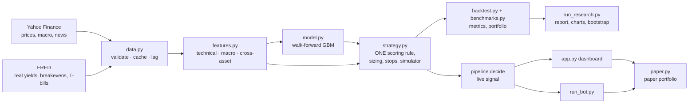

# Aurum

**A research system for gold, silver and gold-mining equities:** walk-forward machine learning, macro drivers, a
cost-aware backtester, honest benchmarks and a paper-trading dashboard.

[](https://github.com/SamBates1/aurum-/actions/workflows/ci.yml)

> Educational research project. Nothing here is investment advice, and paper trading uses simulated money only.

## Objective

Test, with realistic assumptions, whether a combination of macro data (real yields, the dollar, volatility),
technical signals and a machine-learning model can time gold and mining-equity exposure better than simply holding
them. The project prioritises correct methodology over headline returns: every result is out-of-sample, after costs,
compared against simple alternatives and reported with uncertainty intervals.

## Results

Results are generated, not written by hand. Run `python run_research.py` (needs internet) to produce
[`reports/latest/report.md`](reports/latest/report.md) with charts, tables, the untouched-holdout results and data
provenance. The report states the run date, git commit and config fingerprint. Offline runs produce a separate
`reports/latest-synthetic/` report, clearly marked as synthetic and never committed.

## Architecture



The key design decision: **`strategy.py` defines the trading rule once.** The backtest, the live dashboard, the
headless bot and the paper portfolio all call it, and `tests/test_pipeline.py` checks that a live decision equals the
backtested decision for the same inputs.

```
aurum/
  config.py      loads config.yaml (every research choice lives there)
  data.py        downloads, validation, disk cache with provenance, publication lags
  features.py    technical, macro and cross-asset features; labels
  model.py       walk-forward training, purging, diagnostics (AUC, Brier, log loss, calibration)
  strategy.py    scoring rule, decisions, position sizing, stops, cash/share simulator
  backtest.py    performance metrics, benchmark-relative stats, portfolio aggregation
  benchmarks.py  buy & hold, cash, trend, momentum, ML-only, ML-without-macro
  stats.py       stationary block bootstrap, regimes, yearly returns
  signals.py     plain-English reasons; live-only sentiment/fundamental scores
  sentiment.py   headline sentiment (VADER + finance lexicon)
  paper.py       paper portfolio with the same rules as the backtest
  pipeline.py    research() (daily, slow) and decide() (every refresh, fast)
app.py           Streamlit dashboard
run_research.py  full study → results/<timestamp>/ and reports/latest/
run_backtest.py  quick per-ticker backtest
run_bot.py       headless signal loop, optional paper trading
tests/           52 tests: look-ahead, accounting, metrics, risk controls, data handling
```

## Setup

Python 3.10+.

```bash
python -m venv .venv && source .venv/bin/activate    # Windows: .venv\Scripts\activate
pip install -r requirements-dev.txt
```

No API keys are needed: Yahoo Finance and FRED are used without credentials. `.env.example` lists optional settings.

## Running it

| Command | What it does |
|---|---|
| `python run_research.py` | Full study: strategy vs benchmarks, development vs holdout, model diagnostics, cost and threshold sensitivity, bootstrap intervals, regimes, charts and report (a few minutes) |
| `python -m streamlit run app.py` | Dashboard: live signals with reasons, backtest vs benchmarks, paper portfolio, macro charts |
| `python run_backtest.py [TICKERS]` | Quick strategy backtest per ticker |
| `python run_bot.py --paper` | Headless loop: refresh, decide, paper-trade every 60 s |
| `AURUM_OFFLINE=1 <any command>` | Same, on clearly labelled synthetic data (no internet) |
| `pytest` / `ruff check .` | Tests and lint (also run by GitHub Actions on every push) |

Configuration is in [`config.yaml`](config.yaml): universe, macro series, model settings, strategy weights and
thresholds, risk limits, cost assumptions and the holdout date.

## Data

| Source | Series | Use | Limitations |
|---|---|---|---|
| Yahoo Finance | Daily OHLCV for GLD, SLV, GDX, NEM, AEM, WPM; dollar index, 10y yield, VIX, gold and oil futures, S&P 500 | Prices, execution, features | Split/dividend-adjusted; free data with occasional gaps; today's bar is partial until 16:00 New York |
| FRED | 10y TIPS real yield (DFII10), 10y breakeven (T10YIE), 3-month T-bill (DTB3) | Macro features, cash return, risk-free rate | Latest revision rather than original vintage; shifted 2 business days to the date it was known |
| Yahoo Finance | Headlines, fundamentals snapshot | Live context only | No point-in-time history, so never used in backtests and weight 0 by default |

Every download is validated (sorted unique dates, positive prices) and cached under `data/cache/` with its source and
retrieval time. A failed download falls back to the cache **with a visible warning**; nothing is fabricated.

## Strategy

For each ticker, every day at the close:

1. **ML component.** A gradient-boosted classifier (shallow trees, fixed parameters) estimates P(price higher in 5
   trading days) from technical, macro and cross-asset features. Its vote is scaled by its **point-in-time
   out-of-sample AUC**: zero at 0.50 (coin flip), full weight at 0.56. A model without proven skill cannot drive
   decisions.
2. **Technical component.** Trend (price vs 50- and 200-day averages), MACD momentum, RSI extremes.
3. **Score** = weighted average in [-1, 1]. **BUY** at ≥ 0.20 if flat, **SELL** (exit) at ≤ -0.20, otherwise hold.
4. **Execution** at the next day's open, with per-ticker one-way costs (3–10 bps, see config).

**Risk controls** (identical in backtest and paper trading)

* Long-only; each asset is a sleeve of at most `min(20%, 1/N)` of the portfolio.
* Exposure = `min(1, 15% / realised volatility)`, fixed at entry. No averaging in.
* Stop-loss 2 ATRs below entry, never loosened. After a stop, re-entry needs a fresh signal.
* No trading on stale data (last bar older than 4 days) or invalid scores.

## Evaluation methodology

* **Walk-forward:** expanding window, retrained every 63 days, first prediction after 3 years. No random splits.
* **Purging:** labels span 5 days, so the 5 training rows before each test block are dropped. Training never
  contains data after the test block, so no embargo is needed.
* **Holdout:** everything from `2024-01-01` is reported separately. Parameters were fixed before running it.
* **Benchmarks** over identical dates and costs: cash, buy & hold, volatility-sized hold (isolates timing from
  sizing), 200-day trend, 12-1 momentum, technical rule alone, ML alone, ML without macro features (ablation), and
  GDX for the individual miners.
* **Metrics:** CAGR, volatility, Sharpe and Sortino (excess of T-bills; Sortino uses downside deviation over all
  days), max drawdown, Calmar, win rate, average win/loss, holding period, turnover, cost drag, exposure,
  information ratio and beta vs buy & hold.
* **Model diagnostics:** AUC, accuracy vs base rate, precision, recall, Brier score and log loss vs a constant
  forecast, calibration, confusion matrix, AUC per fold, grouped permutation importance.
* **Uncertainty:** stationary block bootstrap (mean block 21 days) for Sharpe and for the Sharpe difference vs
  benchmarks. These are descriptive intervals, not multiple-testing-corrected significance tests.
* **Robustness:** cost sensitivity (0–50 bps), threshold grid (development period only, not used for selection),
  regimes (asset trend, VIX level, real-yield direction), calendar years.

## Tests

`pytest` runs 52 tests offline in under a minute. Highlights:

* **Look-ahead:** features are identical with the future removed; walk-forward predictions don't change when later
  data is added; the purge gap holds; FRED dates shift to publication; partial bars are dropped; model skill only
  uses revealed labels.
* **Accounting:** fills at the next open, exact cost deduction, cash interest, volatility sizing, stop behaviour.
* **Metrics:** Sortino, Sharpe, drawdown, Calmar against hand calculations; zero-volatility and short-sample cases.
* **Regression tests** for every bug fixed in v0.2 (below).

## Changes in v0.2 (audit fixes)

| Problem found in v0.1 | Fix |
|---|---|
| Backtest traded ML probabilities alone; live decisions used a different composite | One rule in `strategy.py`, used everywhere; consistency test |
| `run_bot.py` refreshed prices but reused the morning's features and prediction | Features rebuilt from fresh bars every loop; stale data blocks trading |
| Trades filled at the same close that generated the signal | Fills at the next open |
| Sortino used the std of negative days | Downside deviation over all days vs the risk-free rate |
| Paper BUY top-ups recomputed the stop, which could lower it | No averaging in; stop fixed at entry; regression test |
| Paper trading charged no costs | Per-ticker costs, fees and realised P&L tracked |
| Uninvested cash earned nothing; Sharpe ignored the risk-free rate | T-bill rate for both |
| ML skill weight would have used full-sample AUC (look-ahead) | Point-in-time AUC from revealed labels only |
| FRED lag was one observation | Two business days by date |
| Live signals used today's partial bar, unlike the backtest | Completed bars only by default |

## Known limitations

* **Survivorship bias:** the universe was chosen in 2026; failed or acquired miners are missing.
* **Macro vintages:** FRED revisions aren't point-in-time (market-based series are rarely revised).
* **Execution:** flat cost per ticker; real spreads widen in stress. Paper fills use the last seen price.
* **Small sample of regimes:** about 13 years out-of-sample, one asset class. Results may not generalise.
* **Multiple comparisons:** many strategies and tickers are compared; some will look good by chance.

## Possible extensions

Broker paper trading via API (e.g. Alpaca), ALFRED point-in-time macro vintages, point-in-time fundamentals, separate
risk budgets for ETFs vs single miners, an LLM-based headline classifier evaluated on a labelled history.
