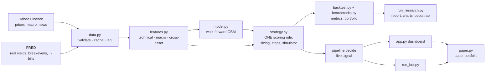

# Aurum

**A research system for gold, silver and gold-mining equities:** walk-forward machine learning, macro drivers, a
cost-aware backtester, honest benchmarks and a paper-trading dashboard.

[](https://github.com/SamBates1/aurum-/actions/workflows/ci.yml)

> Educational research project. Nothing here is investment advice, and paper trading uses simulated money only.

## Objective

Test, with realistic assumptions, whether a combination of macro data (real yields, the dollar, volatility),
technical signals and a machine-learning model can time gold and mining-equity exposure better than simply holding
them. The project prioritises correct methodology over headline returns: every result is out-of-sample, after costs,
compared against simple alternatives and reported with uncertainty intervals.

## Results

Results are generated, not written by hand. Run `python run_research.py` (needs internet) to produce
[`reports/latest/report.md`](reports/latest/report.md) with charts, tables, the untouched-holdout results and data
provenance. The report states the run date, git commit and config fingerprint. Offline runs produce a separate
`reports/latest-synthetic/` report, clearly marked as synthetic and never committed.

## Architecture



The key design decision: **`strategy.py` defines the trading rule once.** The backtest, the live dashboard, the
headless bot and the paper portfolio all call it, and `tests/test_pipeline.py` checks that a live decision equals the
backtested decision for the same inputs.

```
aurum/
  config.py      loads config.yaml (every research choice lives there)
  data.py        downloads, validation, disk cache with provenance, publication lags
  features.py    technical, macro and cross-asset features; labels
  model.py       walk-forward training, purging, diagnostics (AUC, Brier, log loss, calibration)
  strategy.py    scoring rule, decisions, position sizing, stops, cash/share simulator
  backtest.py    performance metrics, benchmark-relative stats, portfolio aggregation
  benchmarks.py  buy & hold, cash, trend, momentum, ML-only, ML-without-macro
  stats.py       stationary block bootstrap, regimes, yearly returns
  signals.py     plain-English reasons; live-only sentiment/fundamental scores
  sentiment.py   headline sentiment (VADER + finance lexicon)
  paper.py       paper portfolio with the same rules as the backtest
  pipeline.py    research() (daily, slow) and decide() (every refresh, fast)
app.py           Streamlit dashboard
run_research.py  full study → results/<timestamp>/ and reports/latest/
run_experiments.py  pre-registered experiments vs the baseline → research/experiments/results/
aurum/experiments.py  experiment variants (EXP-001…019)
aurum/lab.py     research lab: weight-based variants, long history, other assets (EXP-020…028)
aurum/portfolio.py  one-account simulator, the standard backtest (D-028)
aurum/plab.py    portfolio lab: entries, stops, sizing, risk rules (EXP-032…036)
aurum/safety.py  pre-trade checks, off switch, decision records
run_lab.py       runs the research lab → research/experiments/results/<time>-lab-<set>-…/
research/        knowledge base: framework source-code notes, evidence reviews, decisions, experiments
run_backtest.py  quick per-ticker backtest
run_bot.py       headless signal loop, optional paper trading
tests/           99 tests: look-ahead, accounting, metrics, risk controls, data handling, research tools
```

## Setup

Python 3.10+.

```bash
python -m venv .venv && source .venv/bin/activate    # Windows: .venv\Scripts\activate
pip install -r requirements-dev.txt
```

No API keys are needed: Yahoo Finance and FRED are used without credentials. `.env.example` lists optional settings.

**Live prices (optional, recommended):** for real-time charts, put your Alpaca *paper* keys in a file called `.env`
in the project folder (it is git-ignored, never committed and never shown on screen):

```
ALPACA_API_KEY=your-key-id
ALPACA_SECRET_KEY=your-secret
```

Without it the dashboard falls back to Yahoo (delayed) prices, always labelled. GitHub uses the same keys from the
repository Secrets. Aurum never places real orders.

## Running it

| Command | What it does |
|---|---|
| `python run_research.py` | Full study: strategy vs benchmarks, development vs holdout, model diagnostics, cost and threshold sensitivity, bootstrap intervals, regimes, charts and report (a few minutes) |
| `python -m streamlit run app.py` | Dashboard: live signals with reasons, backtest vs benchmarks, paper portfolio, macro charts |
| `python run_experiments.py` | Runs every pre-registered experiment (trend, regimes, models, risk overlays, mean reversion, triple-barrier) against the baseline with DSR, PBO and automatic verdicts (20–40 minutes) |
| `python run_lab.py --set core\|other` | Research lab: the traded strategy and new ideas from 2006 and on eight other precious-metal assets |
| `python run_backtest.py [TICKERS]` | Quick strategy backtest per ticker |
| `python run_bot.py --paper` | Headless loop: paper-trades the approved strategy definitions (70/30 main + risk-capped shadow, D-034); `--engine legacy` runs the gold bot |
| `python run_designer.py` | Every saved strategy on real data: backtest, Fair Test report, decision charts, reproduction check against EXP-045 |
| `AURUM_OFFLINE=1 <any command>` | Same, on clearly labelled synthetic data (no internet) |
| `pytest` / `ruff check .` | Tests and lint (also run by GitHub Actions on every push) |

Configuration is in [`config.yaml`](config.yaml): universe, macro series, model settings, strategy weights and
thresholds, risk limits, cost assumptions and the holdout date.

## Live Analysis (v0.9)

Second page in the list (also opened from each Decision Board row). A TradingView-style chart (Lightweight Charts)
for any US ticker on 5-minute to weekly bars, updating every 2 seconds from Alpaca's IEX feed while the market is
open (labelled: IEX is one exchange; history is consolidated). It shows the strategy's own indicators as the strategy
knew them, its BUY/SELL orders with the full reason on hover, a held/cash band, extra indicators (moving averages,
Bollinger, RSI, MACD, ATR, VWAP, stochastic, ADX, support/resistance) and below it:

- **Summary**: why we might be interested, why we might be wrong (a rule-based devil's advocate), what to do.
- **Trade plan**: what the strategy says, stop, 2R/3R targets, size in pounds within the risk limits, the UK fund,
  what would prove it wrong and confidence checks (an assessment, not a probability).
- **Do the timeframes agree?**, **Decisions over time** (the recorded history and how it turned out), **News** and
  **alerts** (automatic, plus your own price alerts).

Everything uses completed daily closes for decisions. Every evening GitHub records what the main strategy says about
each watchlist ticker in `research/recommendations/` (hash-chained, reproducible; `latest.md`, `outcomes.md`).
Tickers outside the strategy are shown for research only and recorded as NOT COVERED.

## Decision Board (v0.8)

The first page in the list. Choose the strategy to follow, enter your money (or what you already hold), press
**Check now** at any time and get one clear answer per asset: BUY / SELL / HOLD, the amount in pounds, when to act,
which UK-listed fund to use (e.g. VUSA for the S&P 500, SGLN for gold), when to sell, why, and the evidence behind
the strategy. The decision uses the last completed daily close, exactly as tested; while the US market is open a
live preview shows whether today's (delayed) prices would change it. Small live charts show the indicators the
strategy uses, and a watchlist scan covers the other tickers. It is what the strategy says, not personal financial
advice: you place any trade yourself (D-036).

## Paper trading on GitHub

Three paper accounts (simulated money, $10,000 each): **A** 70/30 monthly (main), **B** 70/30 with the 20% risk cap
(shadow), **C** 70/30 rebalanced every day (shadow, so trades show daily; D-038). They run on GitHub after every US close
(`.github/workflows/paper-trading.yml`, `run_paper_daily.py`): yesterday's decisions fill at today's official open,
today's close decides, and `research/paper/` gets the ledgers, a journal, `status.md` and, on Fridays, a weekly report
comparing each account with SPY bought on the same day and with the backtest of the same strategy. Do not also run
`python run_bot.py --paper` on your computer: both would write the same ledgers.

## Strategy Designer (v0.7)

Open the dashboard (`python -m streamlit run app.py`) and choose **Strategy Designer** in the page list.

| Tab | What you can do |
|---|---|
| 1 · Design | Pick assets and starting weights, when to trade, risk sizing, rules built from 14 indicators (price vs moving averages, RSI, momentum, volatility, Bollinger, Donchian, MACD, drawdown...) combined with AND / OR / at-least-k, trailing stops and an account brake. A plain-English summary updates as you go; save versions to `strategies/` or download them |
| 2 · Charts & results | One linked chart: candles with the rule's lines, buy/sell triangles with amounts ($ or £) and % of the account, an indicator panel per rule shaded where the condition was met, rule strips, holdings vs targets, growth and drawdown against SPY and 70/30. Hover any date to see what the strategy knew at that close and what it did; zoom any panel and all follow. Results box, period table, "explain a day", order list, CSV/HTML export |
| 3 · Compare | Several strategies on the same dates and money, including the 2008, 2020 and 2022 downturns |
| 4 · Fair Test & approval | One button runs the pre-registered validation (look-ahead, accounting, costs ×2, execution delay, ±20% sensitivity, PBO, deflated Sharpe, holdout and pre-2013 confirmation); then the eligibility gates and the owner's approval box |
| 5 · Research lab | Vary one number over a grid, scored on the development period only, with every try counted |
| 6 · Scanner | Today's readings for ten ETFs and whether each rule would be met |

Every strategy is one definition file used by the backtest, the charts, the Fair Test and the paper trader
(`aurum/spec.py`, `aurum/engine.py`), so what is charted is exactly what is tested and traded. Other pages:
**Paper Strategies** (both paper ledgers, live prices every minute, labelled as delayed; pending decisions, orders and
the decision log) and **Strategy Registry** (every version tried, status history, Fair Test reports, approvals).
Approvals live in `research/approvals.yaml`; Fair Test reports on real data in `research/fairtests/`.

## AI Quant Desk

An optional conversational research desk is available in the Streamlit multipage navigation. It includes six specialist roles and a whole-team debate mode, using read-only excerpts from the saved research archive. See [the setup guide](docs/QUANT_DESK.md).

The desk defaults to a local Ollama OpenAI-compatible endpoint (`http://localhost:11434/v1`, model `qwen2.5:7b`) to avoid per-token API fees. Install/run Ollama and pull the model (`ollama pull qwen2.5:7b`) before starting Streamlit, or configure `AURUM_LLM_BASE_URL`, `AURUM_LLM_MODEL` and optional `AURUM_LLM_API_KEY` locally. A hosted endpoint may incur charges. No new Python package is required for the chat API client.

This feature does not automatically browse live markets, execute experiments, change strategy code, or place trades. It is an interactive research assistant; generated ideas must be validated with reproducible backtests. Scheduled autonomous research is a future phase.

## Data

| Source | Series | Use | Limitations |
|---|---|---|---|
| Yahoo Finance | Daily OHLCV for GLD, SLV, GDX, NEM, AEM, WPM; dollar index, 10y yield, VIX, gold and oil futures, S&P 500 | Prices, execution, features | Split/dividend-adjusted; free data with occasional gaps; today's bar is partial until 16:00 New York |
| FRED | 10y TIPS real yield (DFII10), 10y breakeven (T10YIE), 3-month T-bill (DTB3) | Macro features, cash return, risk-free rate | Latest revision rather than original vintage; shifted 2 business days to the date it was known |
| Yahoo Finance | Headlines, fundamentals snapshot | Live context only | No point-in-time history, so never used in backtests and weight 0 by default |

Every download is validated (sorted unique dates, positive prices) and cached under `data/cache/` with its source and
retrieval time. A failed download falls back to the cache **with a visible warning**; nothing is fabricated.

## Strategy (v0.6: always invested, sized by risk)

Adopted on 2026-10-29 after experiments EXP-014, EXP-017 and EXP-022 passed their pre-registered rules on real data
with both open- and close-price fills ([decisions D-020, D-021, D-027](research/decisions.md)); the full
evidence and rules are in the [strategy report](research/strategy-report-2026-10-29.md).

For each of the six assets, after each close:

1. **Forecast its risk.** 21-day realised volatility, scaled by gold's implied/realised volatility ratio: the CBOE
   gold volatility index (GVZ) divided by GLD's own 21-day volatility, clipped to 0.5–2. When options price more
   risk than has recently occurred, every position is cut; when they price less, positions grow.
2. **Set the target weight** = min(1, 15% / forecast volatility) of the asset's sleeve (each sleeve is
   `min(20%, 1/N)` of the portfolio). Always invested, never leveraged.
3. **Rebalance** at the next open only if the current weight is more than 5 points off target (decided daily,
   about 39 orders per asset per year; Friday-only decisions are an equivalent setting). Per-ticker one-way costs of 3–10 bps.
4. **Safety:** no trading on stale or missing data, implausible prices, duplicate orders or with the off switch on;
   every planned or blocked order gets a structured record (`aurum/safety.py`). If GVZ is unavailable, sizing falls
   back to plain 21-day volatility with a visible warning.

The ML model and technical signals still run and are shown on the dashboard with their reasons, but they no longer
drive trades: tilting positions by the model's predictions (5-, 21- and 63-day horizons) added nothing on top of
risk-based sizing (EXP-015). The v0.2 BUY/SELL timing strategy (`strategy.mode: timing`) is kept for comparison as
`timing_v02` in every report.

**Headline results** (real data, six assets in one account, after costs, 2006–2026; `run_plab.py`,
[EXP-035](research/experiments/EXP-035-risk-levels-and-robustness.md)):

| | 2006–2013 (new data) CAGR / Sharpe / max DD | 2013–2023 | 2024–2026 | Whole 2006–2026 |
|---|---|---|---|---|
| Traded strategy (daily, GVZ-sized) | 2.3% / 0.15 / −32.4% | 3.4% / 0.24 / −21.1% | 23.1% / 1.30 / −13.0% | 5.5% / 0.37 / −39.1% |
| Buy & hold | 4.7% / 0.28 / −63.9% | 6.0% / 0.30 / −41.1% | 39.5% / 1.01 / −36.7% | 9.5% / 0.39 / −65.2% |

Over twenty years the strategy earned about the **same return per unit of risk as buy & hold** (Sharpe 0.37 vs 0.39) with
a much smaller worst fall (−39% vs −65%; in the 2011–15 gold bear market −38% vs −63%), but less money in total.
It is a smoother way to own gold and miners, not a way to beat owning them: about 70 pre-registered
variants (ML, trend, regimes, fair value, positioning, news indices, stops, scaling, breakers, sizing schemes) failed
to add reliable value. The risk level is a
choice, not an edge: higher targets earn more and fall further at the same Sharpe ([EXP-028](research/experiments/EXP-028-risk-map.md)).
Paper trading is the next test.

## Evaluation methodology

* **Walk-forward:** expanding window, retrained every 63 days, first prediction after 3 years. No random splits.
* **Purging:** labels span 5 days, so the 5 training rows before each test block are dropped. Training never
  contains data after the test block, so no embargo is needed.
* **Holdout:** everything from `2024-01-01` is reported separately. Parameters were fixed before running it.
* **Benchmarks** over identical dates and costs: cash, buy & hold, volatility-sized hold (isolates timing from
  sizing), 200-day trend, 12-1 momentum, technical rule alone, ML alone, ML without macro features (ablation), and
  GDX for the individual miners.
* **Metrics:** CAGR, volatility, Sharpe and Sortino (excess of T-bills; Sortino uses downside deviation over all
  days), max drawdown, Calmar, win rate, average win/loss, holding period, turnover, cost drag, exposure,
  information ratio and beta vs buy & hold.
* **Model diagnostics:** AUC, accuracy vs base rate, precision, recall, Brier score and log loss vs a constant
  forecast, calibration, confusion matrix, AUC per fold, grouped permutation importance.
* **Uncertainty:** stationary block bootstrap (mean block 21 days) for Sharpe and for the Sharpe difference vs
  benchmarks. These are descriptive intervals, not multiple-testing-corrected significance tests.
* **Robustness:** cost sensitivity (0–50 bps), threshold grid (development period only, not used for selection),
  regimes (asset trend, VIX level, real-yield direction), calendar years.

## Tests

`pytest` runs 72 tests offline in about 30 seconds. Highlights:

* **Look-ahead:** features are identical with the future removed; walk-forward predictions don't change when later
  data is added; the purge gap holds; FRED dates shift to publication; partial bars are dropped; model skill only
  uses revealed labels.
* **Accounting:** fills at the next open, exact cost deduction, cash interest, volatility sizing, stop behaviour.
* **Metrics:** Sortino, Sharpe, drawdown, Calmar against hand calculations; zero-volatility and short-sample cases.
* **Regression tests** for every bug fixed in v0.2 (below).

## Research knowledge base (v0.3)

[`research/`](research/README.md) records everything investigated: source-code notes on Freqtrade, LEAN,
Backtrader, VectorBT and Zipline-reloaded at pinned commits; evidence reviews on gold, regimes, ML vs simple
rules, sizing and risk; a 30-row [strategy-transfer matrix](research/transfer-matrix.md); a
[decision log](research/decisions.md); and [pre-registered experiments](research/experiments/README.md) with
acceptance rules written before any results. Changes adopted from the review:

| Finding | Change |
|---|---|
| All four engines that model stops fill them intrabar, with a gap rule; Aurum checked the close (and disagreed with its own paper trader) | Intrabar stop fills (D-012) |
| Freqtrade's look-ahead and recursive analyses | Strategy-level truncation test and warm-up test |
| Best-of-many selection inflates Sharpe | Deflated Sharpe, PSR and PBO in `aurum/stats.py`, reported for every experiment |
| Ideas worth testing (trend, regime gates, model families, risk overlays, triple-barrier exits) | 26 variants in `aurum/experiments.py`, run by `run_experiments.py` |

## Changes in v0.2 (audit fixes)

| Problem found in v0.1 | Fix |
|---|---|
| Backtest traded ML probabilities alone; live decisions used a different composite | One rule in `strategy.py`, used everywhere; consistency test |
| `run_bot.py` refreshed prices but reused the morning's features and prediction | Features rebuilt from fresh bars every loop; stale data blocks trading |
| Trades filled at the same close that generated the signal | Fills at the next open |
| Sortino used the std of negative days | Downside deviation over all days vs the risk-free rate |
| Paper BUY top-ups recomputed the stop, which could lower it | No averaging in; stop fixed at entry; regression test |
| Paper trading charged no costs | Per-ticker costs, fees and realised P&L tracked |
| Uninvested cash earned nothing; Sharpe ignored the risk-free rate | T-bill rate for both |
| ML skill weight would have used full-sample AUC (look-ahead) | Point-in-time AUC from revealed labels only |
| FRED lag was one observation | Two business days by date |
| Live signals used today's partial bar, unlike the backtest | Completed bars only by default |

## Known limitations

* **Survivorship bias:** the universe was chosen in 2026; failed or acquired miners are missing.
* **Macro vintages:** FRED revisions aren't point-in-time (market-based series are rarely revised).
* **Execution:** flat cost per ticker; real spreads widen in stress. Paper fills use the last seen price.
* **Small sample of regimes:** about 13 years out-of-sample, one asset class. Results may not generalise.
* **Multiple comparisons:** many strategies and tickers are compared; some will look good by chance.

## Possible extensions

Broker paper trading via API (e.g. Alpaca), ALFRED point-in-time macro vintages, point-in-time fundamentals, separate
risk budgets for ETFs vs single miners, an LLM-based headline classifier evaluated on a labelled history.
