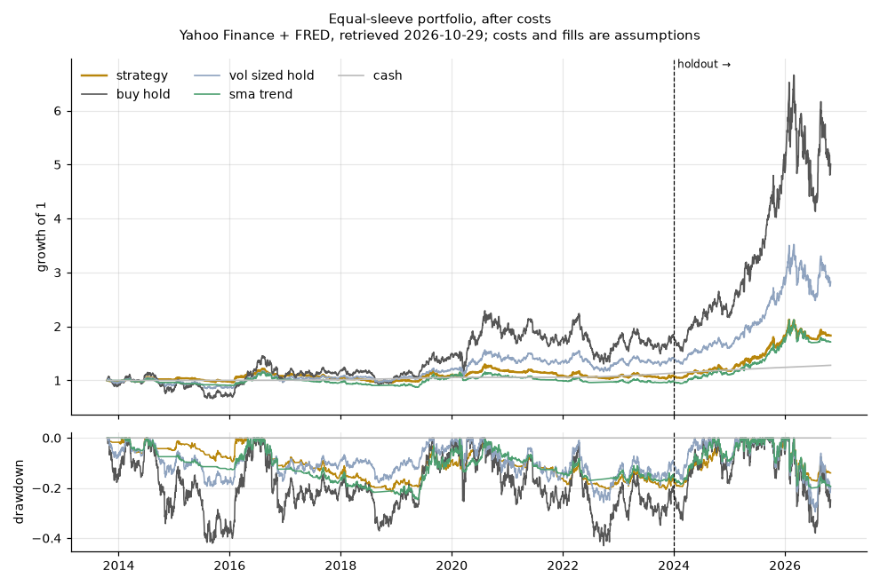
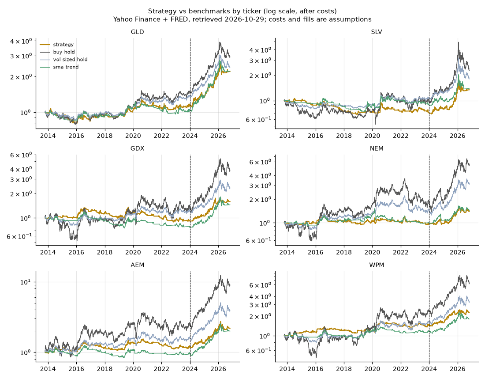
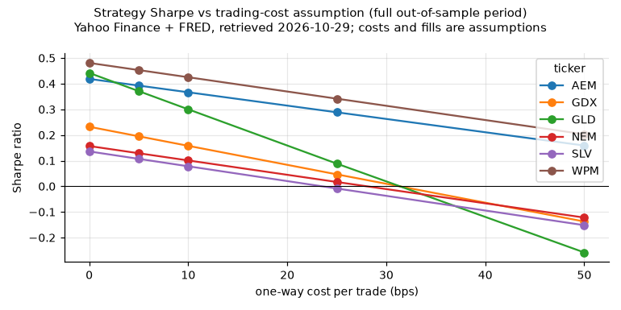
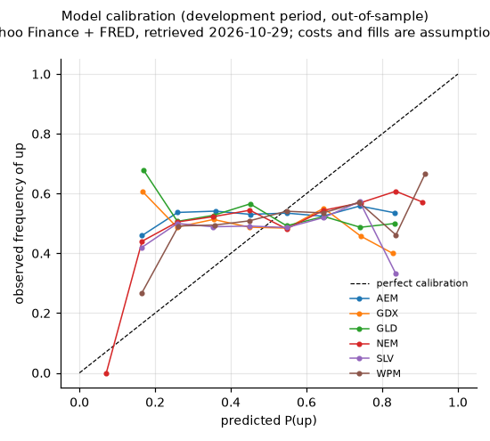
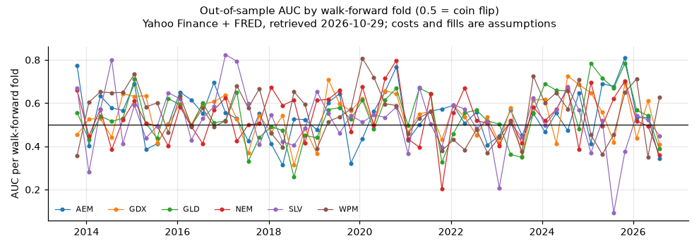
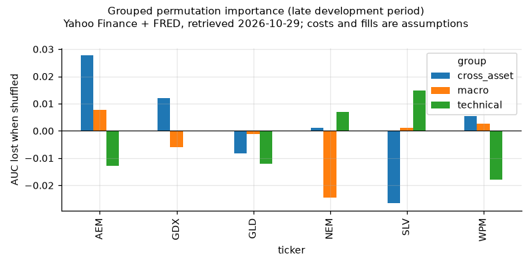
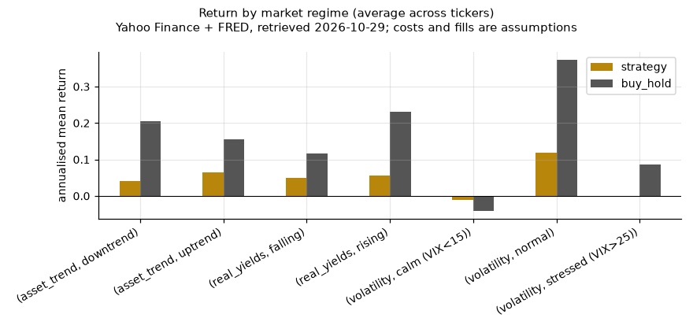

# Aurum research report

**Generated:** 2026-10-29T12:47:02+00:00 · **commit:** `2386c4a` · **config:** `2c9c656d1a4b`

## Setup
* Universe: GLD, SLV, GDX, NEM, AEM, WPM. Out-of-sample period starts 2013-10-18 (after 756 training days).
* **Development:** 2013-10-18 → 2023-12-31. **Untouched holdout:** 2024-01-01 → 2026-10-28.
* Decisions at the close, filled at the next open. Costs per ticker (one-way bps): {'GLD': 3, 'SLV': 5, 'GDX': 5, 'NEM': 8, 'AEM': 10, 'WPM': 10}.
* Cash and the Sharpe risk-free rate use the 3-month T-bill, lagged 2 business days.
* All parameters were fixed in `config.yaml` before this run; nothing below was tuned on the holdout.

## Portfolio results: holdout

Equal sleeves across tickers (each capped at 20%), after costs.

| strategy | cagr | volatility | sharpe | sortino | max_drawdown | calmar | time_in_market | trades | costs_per_year |
|---|---|---|---|---|---|---|---|---|---|
| strategy | 20.8% | 17.2% | 0.938 | 1.250 | -17.2% | 1.213 | 77.0% | 78 | 0.3% |
| buy_hold | 44.2% | 35.8% | 1.083 | 1.506 | -38.0% | 1.163 | 100.0% | 0 | 0.0% |
| vol_sized_hold | 28.3% | 25.1% | 0.949 | 1.295 | -29.5% | 0.959 | 100.0% | 0 | 0.0% |
| sma_trend | 22.2% | 19.5% | 0.910 | 1.212 | -20.0% | 1.111 | 82.5% | 38 | 0.2% |
| momentum | 13.8% | 14.7% | 0.666 | 0.858 | -22.0% | 0.630 | 33.7% | 27 | 0.1% |
| technical_only | 19.1% | 15.0% | 0.955 | 1.246 | -15.7% | 1.212 | 70.7% | 127 | 0.4% |
| ml_only | 17.4% | 7.8% | 1.554 | 2.287 | -5.1% | 3.408 | 48.4% | 179 | 0.6% |
| ml_no_macro | 15.1% | 7.1% | 1.420 | 2.098 | -5.4% | 2.780 | 43.1% | 217 | 0.7% |
| cash | 4.4% | 0.0% | – | – | 0.0% | – | 0.0% | 0 | 0.0% |

## Portfolio results: development

Equal sleeves across tickers (each capped at 20%), after costs.

| strategy | cagr | volatility | sharpe | sortino | max_drawdown | calmar | time_in_market | trades | costs_per_year |
|---|---|---|---|---|---|---|---|---|---|
| strategy | 0.8% | 8.3% | -0.015 | -0.021 | -21.4% | 0.036 | 46.1% | 566 | 0.7% |
| buy_hold | 6.0% | 30.1% | 0.303 | 0.437 | -43.0% | 0.140 | 100.0% | 0 | 0.0% |
| vol_sized_hold | 3.4% | 14.3% | 0.221 | 0.316 | -25.8% | 0.134 | 100.0% | 0 | 0.0% |
| sma_trend | -0.2% | 9.2% | -0.110 | -0.150 | -24.7% | -0.008 | 48.6% | 325 | 0.4% |
| momentum | -0.6% | 5.8% | -0.293 | -0.388 | -15.0% | -0.041 | 24.5% | 283 | 0.3% |
| technical_only | 1.7% | 9.1% | 0.092 | 0.131 | -20.4% | 0.083 | 49.4% | 612 | 0.7% |
| ml_only | -0.5% | 6.0% | -0.266 | -0.366 | -16.8% | -0.031 | 35.5% | 960 | 1.1% |
| ml_no_macro | 0.6% | 5.8% | -0.085 | -0.118 | -20.1% | 0.029 | 36.2% | 825 | 0.9% |
| cash | 1.3% | 0.1% | – | – | -0.0% | 3522.615 | 0.0% | 0 | 0.0% |

## Uncertainty (stationary block bootstrap, 90% intervals)

Descriptive intervals, not a formal significance test. Overlapping labels and many comparisons mean a single good number can easily be luck.

| period | vs | sharpe | sharpe_p05 | sharpe_p95 | sharpe_diff | diff_p05 | diff_p95 | share_resamples_better |
|---|---|---|---|---|---|---|---|---|
| development | buy_hold | -0.015 | -0.550 | 0.556 | -0.318 | -0.662 | 0.017 | 0.054 |
| development | vol_sized_hold | -0.015 | -0.550 | 0.556 | -0.236 | -0.575 | 0.085 | 0.100 |
| development | sma_trend | -0.015 | -0.550 | 0.556 | 0.095 | -0.230 | 0.410 | 0.693 |
| holdout | buy_hold | 0.938 | 0.130 | 1.801 | -0.145 | -0.498 | 0.229 | 0.248 |
| holdout | vol_sized_hold | 0.938 | 0.130 | 1.801 | -0.011 | -0.349 | 0.341 | 0.461 |
| holdout | sma_trend | 0.938 | 0.130 | 1.801 | 0.028 | -0.191 | 0.246 | 0.563 |
| full | buy_hold | 0.307 | -0.130 | 0.713 | -0.184 | -0.440 | 0.077 | 0.120 |
| full | vol_sized_hold | 0.307 | -0.130 | 0.713 | -0.133 | -0.359 | 0.099 | 0.159 |
| full | sma_trend | 0.307 | -0.130 | 0.713 | 0.062 | -0.122 | 0.283 | 0.696 |

## Model quality: holdout

AUC 0.5 = coin flip. Brier/log loss below their baseline (a constant forecast at the base rate) means the probabilities add information.

| ticker | model | n | auc | accuracy | base_rate | brier | brier_baseline | log_loss | log_loss_baseline |
|---|---|---|---|---|---|---|---|---|---|
| GLD | ml_all_features | 704 | 0.532 | 0.585 | 0.604 | 0.251 | 0.239 | 0.697 | 0.671 |
| GLD | ml_technical_only | 704 | 0.562 | 0.536 | 0.604 | 0.251 | 0.239 | 0.696 | 0.671 |
| SLV | ml_all_features | 704 | 0.456 | 0.487 | 0.564 | 0.263 | 0.246 | 0.721 | 0.685 |
| SLV | ml_technical_only | 704 | 0.447 | 0.473 | 0.564 | 0.267 | 0.246 | 0.729 | 0.685 |
| GDX | ml_all_features | 704 | 0.531 | 0.544 | 0.560 | 0.261 | 0.246 | 0.721 | 0.686 |
| GDX | ml_technical_only | 704 | 0.515 | 0.489 | 0.560 | 0.269 | 0.246 | 0.742 | 0.686 |
| NEM | ml_all_features | 704 | 0.507 | 0.484 | 0.571 | 0.264 | 0.245 | 0.725 | 0.683 |
| NEM | ml_technical_only | 704 | 0.511 | 0.511 | 0.571 | 0.267 | 0.245 | 0.732 | 0.683 |
| AEM | ml_all_features | 704 | 0.517 | 0.523 | 0.570 | 0.260 | 0.245 | 0.718 | 0.683 |
| AEM | ml_technical_only | 704 | 0.526 | 0.533 | 0.570 | 0.257 | 0.245 | 0.709 | 0.683 |
| WPM | ml_all_features | 704 | 0.530 | 0.561 | 0.558 | 0.254 | 0.247 | 0.703 | 0.686 |
| WPM | ml_technical_only | 704 | 0.550 | 0.518 | 0.558 | 0.251 | 0.247 | 0.695 | 0.686 |

## By ticker: holdout

| ticker | strategy | cagr | sharpe | max_drawdown | trades |
|---|---|---|---|---|---|
| GLD | strategy | 25.6% | 1.071 | -19.2% | 17 |
| GLD | buy_hold | 27.0% | 1.003 | -26.4% | 0 |
| GLD | vol_sized_hold | 21.7% | 0.939 | -22.7% | 0 |
| SLV | strategy | 25.1% | 0.782 | -35.3% | 12 |
| SLV | buy_hold | 33.7% | 0.793 | -53.9% | 0 |
| SLV | vol_sized_hold | 20.5% | 0.627 | -43.3% | 0 |
| GDX | strategy | 21.5% | 1.003 | -15.5% | 17 |
| GDX | buy_hold | 44.2% | 1.000 | -38.9% | 0 |
| GDX | vol_sized_hold | 25.5% | 0.850 | -28.8% | 0 |
| NEM | strategy | 13.3% | 0.549 | -16.2% | 10 |
| NEM | buy_hold | 46.4% | 1.018 | -36.6% | 0 |
| NEM | vol_sized_hold | 31.4% | 0.939 | -25.5% | 0 |
| AEM | strategy | 23.4% | 0.919 | -23.3% | 14 |
| AEM | buy_hold | 56.7% | 1.233 | -45.8% | 0 |
| AEM | vol_sized_hold | 37.1% | 1.091 | -38.1% | 0 |
| WPM | strategy | 16.8% | 0.761 | -15.7% | 8 |
| WPM | buy_hold | 41.7% | 0.968 | -37.4% | 0 |
| WPM | vol_sized_hold | 28.4% | 0.862 | -30.1% | 0 |

## Data warnings during this run

* `warning` CL=F: dropped 1 rows with missing/non-positive close

## Known limitations
* **Survivorship:** the universe was chosen today. Miners that failed or were acquired before today are absent.
* **Macro vintages:** FRED values are the latest revision, lagged for publication delay. Market-based series
  (TIPS yields, breakevens, T-bills) are rarely revised, but this is not a true point-in-time (ALFRED) dataset.
* **Sentiment and fundamentals** have no free point-in-time history, so they are excluded from all backtests
  and carry zero weight in live decisions by default.
* **Execution:** fills at the next open with a flat cost assumption; real spreads widen in stress and large
  orders move prices. See the cost-sensitivity chart.
* **Multiple comparisons:** several strategies and tickers are compared; the best of many will look good by chance.
