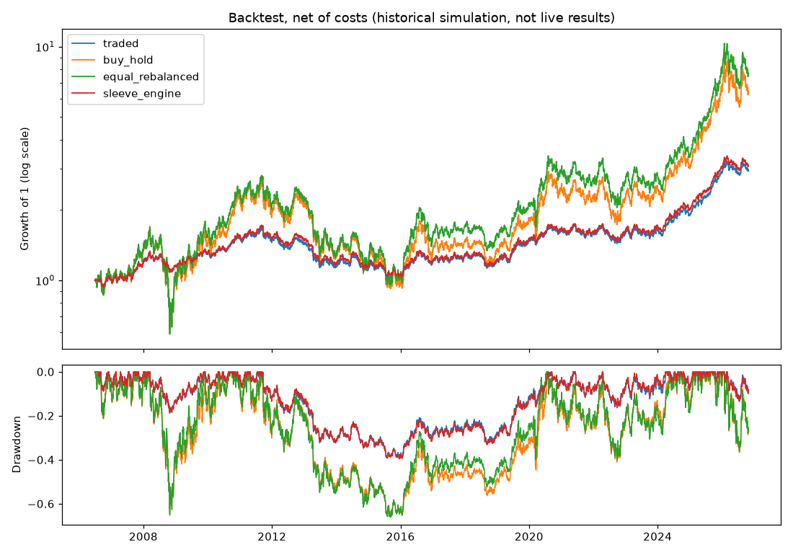
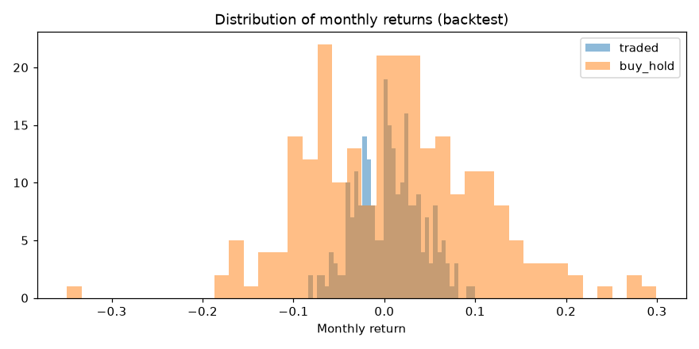

# Portfolio lab: core set, 2026-10-29T14:40 UTC (real)

Historical simulation (backtest), not live results. Assets: GLD, SLV, GDX, NEM, AEM, WPM; one account from 2006-06-30. Periods: pre 2006-06-30 → 2013-10-17; dev 2013-10-18 → 2023-12-31; holdout 2024-01-01 → now. Orders fill at the next open, decided daily; net of per-asset costs. Baseline = `traded`. 19 trial variants; PBO (development) 40%.

## Return, risk and Sharpe by period

| Exp | Variant | pre CAGR / Sharpe / max DD | dev CAGR / Sharpe / max DD | holdout CAGR / Sharpe / max DD | Whole period | Exposure | Costs/yr |
|---|---|---|---|---|---|---|---|
| BASE | traded | +2.3% / +0.15 / -32.4% | +3.4% / +0.24 / -21.1% | +23.1% / +1.30 / -13.0% | +5.5% / +0.37 / -39.1% | 47% | 0.20% |
| REF | sleeve_engine | +2.8% / +0.19 / -32.1% | +3.4% / +0.24 / -22.0% | +23.6% / +1.33 / -13.4% | +5.7% / +0.38 / -39.7% | 49% | 0.20% |
| REF | buy_hold | +4.7% / +0.28 / -63.9% | +6.0% / +0.30 / -41.1% | +39.5% / +1.01 / -36.7% | +9.5% / +0.39 / -65.2% | 100% | 0.00% |
| REF | equal_rebalanced | +4.9% / +0.29 / -65.2% | +7.1% / +0.34 / -40.8% | +42.1% / +1.07 / -35.9% | +10.5% / +0.42 / -66.1% | 100% | 0.04% |
| REF | weekly | +1.9% / +0.12 / -33.3% | +3.6% / +0.25 / -22.0% | +23.8% / +1.32 / -12.3% | +5.5% / +0.37 / -40.0% | 47% | 0.14% |
| REF | daily | +2.3% / +0.15 / -32.4% | +3.4% / +0.24 / -21.1% | +23.1% / +1.30 / -13.0% | +5.5% / +0.37 / -39.1% | 47% | 0.20% |
| EXP-032 | dca_12m | +2.5% / +0.17 / -32.4% | +3.4% / +0.24 / -21.1% | +23.1% / +1.30 / -13.0% | +5.5% / +0.37 / -39.1% | 46% | 0.20% |
| EXP-032 | add_to_winners | +2.6% / +0.17 / -33.9% | +3.0% / +0.20 / -23.3% | +26.9% / +1.31 / -15.2% | +5.8% / +0.37 / -41.9% | 52% | 0.30% |
| EXP-032 | average_down | +2.2% / +0.14 / -36.4% | +4.0% / +0.27 / -23.9% | +24.2% / +1.28 / -14.7% | +5.9% / +0.37 / -43.3% | 51% | 0.29% |
| EXP-032 | buy_pullbacks | +2.4% / +0.15 / -32.6% | +3.4% / +0.24 / -21.1% | +23.4% / +1.30 / -13.3% | +5.5% / +0.37 / -39.3% | 47% | 0.25% |
| EXP-033 | trail_15pct | +0.8% / +0.01 / -28.0% | +1.2% / +0.04 / -19.1% | +18.6% / +1.16 / -14.9% | +3.3% / +0.20 / -38.7% | 39% | 0.29% |
| EXP-033 | trail_25pct | +1.9% / +0.11 / -31.8% | +2.6% / +0.18 / -18.0% | +21.5% / +1.26 / -13.3% | +4.7% / +0.32 / -37.7% | 44% | 0.24% |
| EXP-033 | trend_exit_200 | +2.5% / +0.19 / -14.3% | +0.3% / -0.09 / -19.1% | +21.2% / +1.32 / -9.9% | +3.8% / +0.28 / -22.5% | 28% | 0.37% |
| EXP-033 | trend_half_200 | +2.5% / +0.17 / -23.6% | +1.8% / +0.11 / -16.7% | +22.2% / +1.33 / -11.3% | +4.6% / +0.34 / -31.1% | 37% | 0.26% |
| EXP-033 | trim_overextended | +2.2% / +0.14 / -32.4% | +3.3% / +0.23 / -20.9% | +22.1% / +1.36 / -10.8% | +5.3% / +0.36 / -38.9% | 45% | 0.22% |
| EXP-033 | breaker_15 | +3.1% / +0.23 / -25.1% | +2.5% / +0.20 / -16.1% | +23.1% / +1.30 / -13.0% | +5.4% / +0.40 / -29.4% | 36% | 0.17% |
| EXP-033 | breaker_25 | +2.6% / +0.17 / -29.1% | +2.5% / +0.18 / -16.4% | +23.1% / +1.30 / -13.0% | +5.1% / +0.37 / -33.6% | 38% | 0.18% |
| EXP-033 | weekly_loss_limit | +2.3% / +0.15 / -32.3% | +3.1% / +0.22 / -21.1% | +23.1% / +1.30 / -13.0% | +5.3% / +0.36 / -39.7% | 46% | 0.22% |
| EXP-033 | equity_curve_filter | +1.3% / +0.05 / -22.1% | +2.5% / +0.18 / -16.9% | +21.4% / +1.30 / -10.1% | +4.4% / +0.33 / -31.1% | 34% | 0.28% |
| EXP-034 | fixed_weights | +5.0% / +0.27 / -45.8% | +5.8% / +0.34 / -26.3% | +27.6% / +1.06 / -22.0% | +8.3% / +0.41 / -45.8% | 60% | 0.03% |
| EXP-034 | inverse_vol_alloc | +2.3% / +0.15 / -32.2% | +3.4% / +0.24 / -20.9% | +23.1% / +1.30 / -13.0% | +5.5% / +0.37 / -38.9% | 47% | 0.20% |
| EXP-034 | portfolio_vol_12 | +2.6% / +0.17 / -30.1% | +3.2% / +0.22 / -22.2% | +22.7% / +1.31 / -9.9% | +5.4% / +0.35 / -39.5% | 46% | 0.10% |
| EXP-034 | miners_cap_40 | +2.3% / +0.15 / -32.3% | +3.4% / +0.24 / -21.1% | +23.1% / +1.30 / -13.0% | +5.5% / +0.37 / -39.0% | 47% | 0.19% |
| EXP-034 | cash_reserve_10 | +2.3% / +0.15 / -29.2% | +3.3% / +0.24 / -19.2% | +21.0% / +1.29 / -11.9% | +5.2% / +0.37 / -35.4% | 42% | 0.17% |
| EXP-034 | fixed_fractional_atr | +2.2% / +0.14 / -16.9% | +1.1% / +0.03 / -26.4% | +21.1% / +1.21 / -12.6% | +4.0% / +0.26 / -27.7% | 37% | 0.67% |
| EXP-035 | conservative_10 | +2.1% / +0.15 / -22.4% | +3.0% / +0.25 / -15.0% | +16.9% / +1.31 / -8.4% | +4.4% / +0.37 / -28.0% | 32% | 0.11% |
| EXP-035 | aggressive_20 | +2.4% / +0.15 / -39.9% | +3.9% / +0.25 / -26.2% | +28.6% / +1.27 / -17.5% | +6.4% / +0.37 / -47.6% | 59% | 0.28% |

## Versus the traded rule (ΔSharpe; share of block-bootstrap resamples better)

| Exp | Variant | pre ΔSharpe (better) | dev ΔSharpe (better) | holdout ΔSharpe (better) | dev 2× cost | DSR | Verdict |
|---|---|---|---|---|---|---|---|
| BASE | traded | +0.00 (0%) | +0.00 (0%) | +0.00 (0%) | +0.00 | 0.57 | baseline |
| REF | sleeve_engine | +0.04 (97%) | -0.00 (48%) | +0.04 (74%) | +0.00 | – | reference |
| REF | buy_hold | +0.13 (83%) | +0.06 (72%) | -0.29 (6%) | +0.09 | – | reference |
| REF | equal_rebalanced | +0.13 (83%) | +0.10 (86%) | -0.23 (6%) | +0.12 | – | reference |
| REF | weekly | -0.03 (23%) | +0.02 (72%) | +0.02 (66%) | +0.02 | – | reference |
| REF | daily | +0.00 (0%) | +0.00 (0%) | +0.00 (0%) | +0.00 | – | reference |
| EXP-032 | dca_12m | +0.02 (63%) | +0.00 (92%) | +0.00 (53%) | -0.00 | – | descriptive |
| EXP-032 | add_to_winners | +0.02 (72%) | -0.04 (8%) | +0.01 (56%) | -0.04 | 0.52 | REJECT |
| EXP-032 | average_down | -0.01 (41%) | +0.03 (90%) | -0.01 (41%) | +0.03 | 0.61 | INCONCLUSIVE |
| EXP-032 | buy_pullbacks | +0.00 (63%) | -0.00 (48%) | +0.00 (58%) | -0.00 | 0.57 | REJECT |
| EXP-033 | trail_15pct | -0.14 (12%) | -0.20 (2%) | -0.13 (21%) | -0.21 | 0.32 | REJECT |
| EXP-033 | trail_25pct | -0.04 (31%) | -0.06 (13%) | -0.04 (36%) | -0.06 | 0.49 | REJECT |
| EXP-033 | trend_exit_200 | +0.04 (59%) | -0.32 (5%) | +0.02 (54%) | -0.36 | 0.19 | REJECT |
| EXP-033 | trend_half_200 | +0.02 (61%) | -0.13 (5%) | +0.03 (64%) | -0.14 | 0.40 | REJECT |
| EXP-033 | trim_overextended | -0.01 (35%) | -0.00 (44%) | +0.06 (82%) | -0.00 | 0.56 | REJECT |
| EXP-033 | breaker_15 | +0.07 (77%) | -0.04 (34%) | -0.00 (4%) | -0.04 | 0.51 | REJECT |
| EXP-033 | breaker_25 | +0.02 (70%) | -0.06 (30%) | +0.00 (91%) | -0.06 | 0.49 | REJECT |
| EXP-033 | weekly_loss_limit | -0.00 (39%) | -0.02 (20%) | +0.01 (74%) | -0.02 | 0.54 | REJECT |
| EXP-033 | equity_curve_filter | -0.10 (23%) | -0.05 (27%) | +0.01 (51%) | -0.02 | 0.50 | REJECT |
| EXP-034 | fixed_weights | +0.12 (80%) | +0.10 (86%) | -0.24 (6%) | +0.12 | 0.69 | REJECT (failed on holdout) |
| EXP-034 | inverse_vol_alloc | -0.00 (19%) | +0.00 (61%) | +0.00 (68%) | +0.00 | 0.57 | INCONCLUSIVE |
| EXP-034 | portfolio_vol_12 | +0.02 (59%) | -0.02 (37%) | +0.01 (52%) | -0.01 | 0.54 | REJECT |
| EXP-034 | miners_cap_40 | -0.00 (32%) | +0.00 (68%) | +0.00 (72%) | +0.01 | 0.57 | INCONCLUSIVE |
| EXP-034 | cash_reserve_10 | +0.00 (50%) | +0.01 (73%) | -0.01 (16%) | +0.01 | 0.57 | INCONCLUSIVE |
| EXP-034 | fixed_fractional_atr | -0.01 (48%) | -0.20 (10%) | -0.09 (36%) | -0.25 | 0.31 | REJECT |
| EXP-035 | conservative_10 | -0.00 (42%) | +0.02 (86%) | +0.01 (65%) | +0.02 | – | descriptive |
| EXP-035 | aggressive_20 | +0.00 (59%) | +0.01 (82%) | -0.03 (11%) | +0.01 | – | descriptive |

## Consistency and tails (whole period, monthly returns)

| Variant | Months up | Profit factor | Avg up month | Avg down month | Worst month | Worst day | CVaR 5% (day) | Longest time below peak | Time below peak |
|---|---|---|---|---|---|---|---|---|---|
| traded | 58% | 1.42 | +2.9% | -2.9% | -8.3% | -4.7% | -1.7% | 2239 days | 95% |
| sleeve_engine | 57% | 1.44 | +3.0% | -2.8% | -8.3% | -5.3% | -1.7% | 2239 days | 95% |
| buy_hold | 56% | 1.38 | +7.7% | -6.9% | -34.9% | -15.3% | -4.7% | 2235 days | 97% |
| equal_rebalanced | 58% | 1.42 | +7.3% | -7.2% | -35.2% | -14.8% | -4.8% | 2227 days | 96% |
| weekly | 58% | 1.42 | +3.0% | -2.9% | -8.7% | -4.8% | -1.7% | 2241 days | 95% |
| daily | 58% | 1.42 | +2.9% | -2.9% | -8.3% | -4.7% | -1.7% | 2239 days | 95% |
| dca_12m | 58% | 1.43 | +2.9% | -2.8% | -8.3% | -4.7% | -1.7% | 2239 days | 95% |
| add_to_winners | 57% | 1.41 | +3.4% | -3.1% | -9.1% | -4.7% | -1.9% | 2240 days | 96% |
| average_down | 58% | 1.41 | +3.3% | -3.2% | -9.7% | -5.7% | -1.9% | 2430 days | 95% |
| buy_pullbacks | 58% | 1.42 | +3.0% | -2.9% | -8.5% | -4.7% | -1.7% | 2233 days | 95% |
| trail_15pct | 52% | 1.30 | +2.6% | -2.2% | -7.7% | -4.1% | -1.5% | 3377 days | 97% |
| trail_25pct | 56% | 1.38 | +2.8% | -2.6% | -10.1% | -4.4% | -1.6% | 3192 days | 96% |
| trend_exit_200 | 56% | 1.45 | +2.0% | -1.7% | -6.6% | -4.0% | -1.4% | 2220 days | 96% |
| trend_half_200 | 55% | 1.44 | +2.5% | -2.1% | -6.7% | -4.0% | -1.5% | 2230 days | 96% |
| trim_overextended | 58% | 1.42 | +2.8% | -2.7% | -8.3% | -4.7% | -1.6% | 2436 days | 95% |
| breaker_15 | 60% | 1.51 | +2.4% | -2.3% | -7.0% | -4.0% | -1.5% | 2230 days | 95% |
| breaker_25 | 58% | 1.46 | +2.5% | -2.4% | -8.4% | -4.7% | -1.6% | 3186 days | 96% |
| weekly_loss_limit | 58% | 1.41 | +3.0% | -2.8% | -8.3% | -4.7% | -1.7% | 3164 days | 95% |
| equity_curve_filter | 55% | 1.44 | +2.4% | -2.0% | -6.3% | -4.0% | -1.4% | 2423 days | 96% |
| fixed_weights | 59% | 1.46 | +4.4% | -4.3% | -22.1% | -9.0% | -2.9% | 2163 days | 96% |
| inverse_vol_alloc | 58% | 1.42 | +2.9% | -2.8% | -8.4% | -4.7% | -1.7% | 2237 days | 95% |
| portfolio_vol_12 | 58% | 1.43 | +2.9% | -2.8% | -9.9% | -5.7% | -1.8% | 2239 days | 94% |
| miners_cap_40 | 58% | 1.42 | +2.9% | -2.9% | -8.3% | -4.7% | -1.7% | 2233 days | 95% |
| cash_reserve_10 | 58% | 1.44 | +2.7% | -2.5% | -7.5% | -4.2% | -1.5% | 2230 days | 95% |
| fixed_fractional_atr | 48% | 1.34 | +3.1% | -2.2% | -5.2% | -6.6% | -1.7% | 1741 days | 97% |
| conservative_10 | 59% | 1.49 | +2.0% | -1.9% | -5.8% | -3.1% | -1.1% | 2184 days | 94% |
| aggressive_20 | 58% | 1.40 | +3.8% | -3.8% | -10.3% | -6.1% | -2.2% | 2436 days | 96% |

## Stress windows (return / worst fall)

| Window | traded | buy_hold | equal_rebalanced | trend_exit_200 | breaker_15 | miners_cap_40 |
|---|---|---|---|---|---|---|
| 2008 financial crisis | -11.3% / -18.8% | -35.7% / -63.9% | -32.6% / -65.2% | -7.8% / -9.6% | -12.1% / -17.3% | -11.3% / -18.8% |
| 2011-15 gold bear market | -37.7% / -39.1% | -62.8% / -65.2% | -62.3% / -66.1% | -20.2% / -21.3% | -28.0% / -29.3% | -37.6% / -39.0% |
| 2013 gold crash | -14.6% / -16.5% | -30.5% / -34.9% | -30.2% / -35.2% | +0.0% / +0.0% | -7.1% / -8.2% | -14.6% / -16.5% |
| 2020 Covid crash | -5.3% / -8.4% | -14.2% / -24.6% | -14.1% / -24.8% | -4.7% / -6.0% | -5.3% / -8.4% | -5.3% / -8.4% |
| 2022 rate rises | -10.8% / -16.4% | -24.9% / -37.8% | -25.3% / -38.7% | -3.1% / -7.7% | -11.3% / -16.1% | -10.8% / -16.4% |

## Market regimes (annualised mean return / volatility; descriptive, regimes defined on GLD and GVZ)

**trend**

| State | days | breaker_15 | buy_hold | equal_rebalanced | traded | trend_exit_200 |
|---|---|---|---|---|---|---|
| bear | 1023 | -12.0% / 8% | -38.0% / 39% | -38.4% / 42% | -17.8% / 12% | -3.2% / 2% |
| bull | 2456 | +19.2% / 11% | +49.6% / 32% | +51.0% / 32% | +22.2% / 12% | +16.1% / 11% |
| sideways | 1437 | -5.0% / 9% | -8.6% / 28% | -6.7% / 29% | -4.8% / 11% | -11.9% / 6% |

**volatility**

| State | days | breaker_15 | buy_hold | equal_rebalanced | traded | trend_exit_200 |
|---|---|---|---|---|---|---|
| high vol | 1544 | +2.9% / 12% | +11.1% / 44% | +14.3% / 46% | +2.2% / 13% | +3.2% / 9% |
| low vol | 1545 | +5.7% / 7% | +8.6% / 21% | +8.7% / 21% | +4.3% / 11% | -1.7% / 7% |
| medium vol | 1543 | +6.4% / 9% | +20.5% / 28% | +21.1% / 29% | +9.6% / 11% | +9.1% / 8% |

**liquidity**

| State | days | breaker_15 | buy_hold | equal_rebalanced | traded | trend_exit_200 |
|---|---|---|---|---|---|---|
| normal volume | 4400 | +6.2% / 11% | +14.8% / 34% | +16.3% / 35% | +6.4% / 13% | +4.5% / 9% |
| thin volume | 656 | +4.9% / 5% | +16.0% / 15% | +15.0% / 16% | +6.1% / 6% | +3.6% / 4% |

## Investing all at once vs over 12 months (3-year outcomes from every monthly start)

207 start dates. Spreading the start over 12 months ended ahead in **46%** of them. Average 3-year return: lump sum +15.5%, spread +14.6%; worst: lump sum -30.4%, spread -27.0%; average worst fall: lump sum -18.1%, spread -16.1%.

## Robustness: Sharpe for nearby settings (whole period, net)

Rows: volatility target; columns: rebalance band. One table per volatility window. The current setting is 15% / 5 points / 21 days.

**10-day volatility**

| Target vol | band 0 | band 0.025 | band 0.05 | band 0.1 |
|---|---|---|---|---|
| 10.0% | 0.34 | 0.35 | 0.37 | 0.35 |
| 12.5% | 0.34 | 0.34 | 0.37 | 0.36 |
| 15.0% | 0.34 | 0.34 | 0.36 | 0.37 |
| 17.5% | 0.34 | 0.34 | 0.35 | 0.36 |
| 20.0% | 0.33 | 0.34 | 0.35 | 0.37 |

**21-day volatility**

| Target vol | band 0 | band 0.025 | band 0.05 | band 0.1 |
|---|---|---|---|---|
| 10.0% | 0.37 | 0.38 | 0.37 | 0.36 |
| 12.5% | 0.37 | 0.37 | 0.37 | 0.40 |
| 15.0% | 0.36 | 0.37 | 0.37 | 0.38 |
| 17.5% | 0.36 | 0.37 | 0.37 | 0.38 |
| 20.0% | 0.36 | 0.37 | 0.37 | 0.37 |

**63-day volatility**

| Target vol | band 0 | band 0.025 | band 0.05 | band 0.1 |
|---|---|---|---|---|
| 10.0% | 0.39 | 0.39 | 0.40 | 0.42 |
| 12.5% | 0.38 | 0.39 | 0.40 | 0.40 |
| 15.0% | 0.38 | 0.39 | 0.40 | 0.40 |
| 17.5% | 0.37 | 0.38 | 0.38 | 0.39 |
| 20.0% | 0.37 | 0.37 | 0.38 | 0.38 |

## Cost sensitivity (same one-way cost on every asset)

| bps | CAGR | Sharpe |
|---|---|---|
| 0 | +5.7% | +0.38 |
| 5 | +5.5% | +0.37 |
| 10 | +5.4% | +0.36 |
| 25 | +4.9% | +0.32 |
| 50 | +4.1% | +0.26 |

## What normal looks like (traded rule, every rolling window in the history)

| Window | 1st pct | 5th pct | 25th | median | 75th | 95th | Share of windows with a loss |
|---|---|---|---|---|---|---|---|
| 1 month | -7.6% | -5.1% | -2.0% | +0.5% | +3.0% | +6.0% | 44% |
| 3 months | -12.5% | -8.7% | -2.4% | +1.6% | +5.7% | +11.7% | 39% |
| 6 months | -17.2% | -10.7% | -3.1% | +2.9% | +9.0% | +19.0% | 37% |
| 1 year | -20.5% | -13.2% | -4.0% | +4.5% | +16.9% | +30.0% | 38% |

Verdicts are proposals. A change is only adopted when recorded in research/decisions.md.
