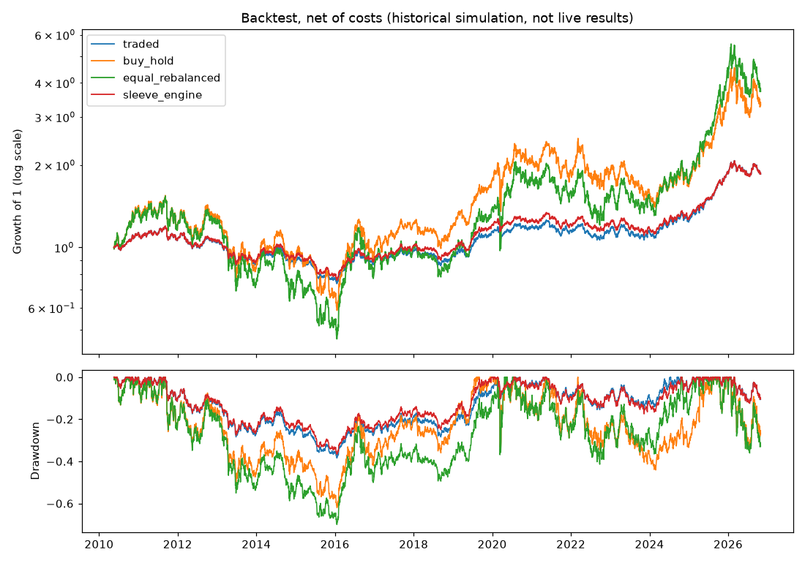
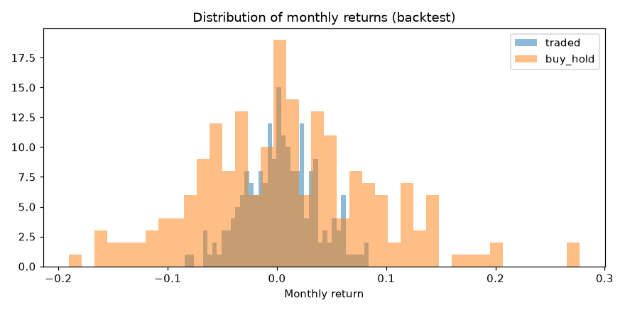

# Portfolio lab: other set, 2026-10-29T14:42 UTC (real)

Historical simulation (backtest), not live results. Assets: GDXJ, SIL, RGLD, FNV, KGC, AU, PPLT, PALL; one account from 2010-05-19. Periods: pre 2010-05-19 → 2013-10-17; dev 2013-10-18 → 2023-12-31; holdout 2024-01-01 → now. Orders fill at the next open, decided daily; net of per-asset costs. Baseline = `traded`. 19 trial variants; PBO (development) 38%.

## Return, risk and Sharpe by period

| Exp | Variant | pre CAGR / Sharpe / max DD | dev CAGR / Sharpe / max DD | holdout CAGR / Sharpe / max DD | Whole period | Exposure | Costs/yr |
|---|---|---|---|---|---|---|---|
| BASE | traded | -2.9% / -0.22 / -28.4% | +2.3% / +0.15 / -26.7% | +19.0% / +1.11 / -12.4% | +3.8% / +0.26 / -38.5% | 41% | 0.34% |
| REF | sleeve_engine | -2.5% / -0.18 / -27.7% | +2.5% / +0.17 / -26.3% | +17.8% / +1.03 / -12.5% | +3.9% / +0.26 / -36.7% | 42% | 0.36% |
| REF | buy_hold | -2.5% / +0.06 / -50.9% | +5.6% / +0.29 / -49.2% | +30.3% / +0.83 / -34.2% | +7.6% / +0.34 / -62.0% | 100% | 0.00% |
| REF | equal_rebalanced | -5.5% / -0.04 / -55.1% | +6.2% / +0.31 / -53.8% | +38.1% / +0.96 / -36.1% | +8.3% / +0.36 / -70.0% | 100% | 0.08% |
| REF | weekly | -2.4% / -0.17 / -28.3% | +2.3% / +0.15 / -28.4% | +19.2% / +1.11 / -12.0% | +4.0% / +0.27 / -39.0% | 41% | 0.23% |
| REF | daily | -2.9% / -0.22 / -28.4% | +2.3% / +0.15 / -26.7% | +19.0% / +1.11 / -12.4% | +3.8% / +0.26 / -38.5% | 41% | 0.34% |
| EXP-032 | dca_12m | -4.6% / -0.42 / -28.4% | +2.3% / +0.15 / -26.7% | +19.0% / +1.11 / -12.4% | +3.5% / +0.23 / -38.5% | 40% | 0.33% |
| EXP-032 | add_to_winners | -3.3% / -0.24 / -30.0% | +2.4% / +0.15 / -28.3% | +21.4% / +1.10 / -13.9% | +4.1% / +0.27 / -40.8% | 45% | 0.47% |
| EXP-032 | average_down | -4.1% / -0.28 / -32.8% | +2.5% / +0.16 / -30.8% | +19.6% / +1.06 / -14.3% | +3.8% / +0.24 / -43.8% | 46% | 0.47% |
| EXP-032 | buy_pullbacks | -3.0% / -0.23 / -28.8% | +2.2% / +0.14 / -26.8% | +19.7% / +1.14 / -12.3% | +3.9% / +0.26 / -38.8% | 41% | 0.41% |
| EXP-033 | trail_15pct | -5.0% / -0.56 / -28.7% | +1.0% / +0.01 / -22.1% | +14.5% / +0.95 / -13.3% | +1.8% / +0.08 / -36.8% | 32% | 0.46% |
| EXP-033 | trail_25pct | -4.1% / -0.38 / -28.4% | +0.5% / -0.03 / -26.0% | +17.3% / +1.04 / -14.2% | +2.2% / +0.11 / -40.4% | 37% | 0.40% |
| EXP-033 | trend_exit_200 | -0.2% / -0.02 / -13.3% | +1.1% / +0.01 / -18.9% | +14.7% / +0.95 / -9.9% | +3.0% / +0.24 / -18.9% | 22% | 0.55% |
| EXP-033 | trend_half_200 | -1.5% / -0.15 / -20.4% | +1.9% / +0.12 / -18.7% | +17.0% / +1.07 / -10.9% | +3.6% / +0.27 / -28.2% | 31% | 0.41% |
| EXP-033 | trim_overextended | -2.8% / -0.22 / -28.4% | +2.2% / +0.15 / -26.6% | +17.8% / +1.13 / -9.8% | +3.6% / +0.24 / -38.3% | 39% | 0.37% |
| EXP-033 | breaker_15 | -1.6% / -0.15 / -23.4% | +1.3% / +0.05 / -15.5% | +18.5% / +1.09 / -12.4% | +3.4% / +0.25 / -29.0% | 29% | 0.27% |
| EXP-033 | breaker_25 | -3.3% / -0.28 / -27.6% | +2.2% / +0.16 / -17.2% | +19.0% / +1.11 / -12.4% | +3.7% / +0.26 / -34.3% | 33% | 0.30% |
| EXP-033 | weekly_loss_limit | -3.0% / -0.24 / -27.9% | +2.4% / +0.16 / -26.7% | +19.1% / +1.12 / -12.4% | +3.9% / +0.26 / -38.7% | 40% | 0.35% |
| EXP-033 | equity_curve_filter | -2.3% / -0.29 / -19.8% | +1.5% / +0.08 / -20.1% | +18.7% / +1.19 / -9.6% | +3.4% / +0.26 / -29.8% | 30% | 0.44% |
| EXP-034 | fixed_weights | -2.0% / -0.03 / -36.3% | +5.5% / +0.31 / -35.4% | +25.6% / +0.96 / -22.0% | +7.0% / +0.36 / -48.0% | 60% | 0.04% |
| EXP-034 | inverse_vol_alloc | -2.9% / -0.22 / -28.4% | +2.4% / +0.16 / -26.6% | +19.2% / +1.12 / -12.4% | +3.9% / +0.26 / -38.3% | 41% | 0.35% |
| EXP-034 | portfolio_vol_12 | -4.5% / -0.33 / -29.5% | +2.7% / +0.18 / -29.1% | +20.4% / +1.19 / -9.1% | +3.9% / +0.25 / -41.4% | 43% | 0.19% |
| EXP-034 | miners_cap_40 | -2.8% / -0.21 / -28.1% | +2.4% / +0.16 / -26.7% | +19.0% / +1.11 / -12.4% | +3.9% / +0.27 / -38.2% | 40% | 0.32% |
| EXP-034 | cash_reserve_10 | -2.6% / -0.22 / -26.0% | +2.3% / +0.15 / -24.5% | +17.6% / +1.11 / -11.1% | +3.7% / +0.26 / -35.3% | 37% | 0.29% |
| EXP-034 | fixed_fractional_atr | -1.0% / -0.03 / -19.7% | +1.3% / +0.07 / -30.8% | +24.8% / +1.21 / -15.8% | +4.4% / +0.28 / -34.4% | 42% | 1.30% |
| EXP-035 | conservative_10 | -2.0% / -0.25 / -19.9% | +2.1% / +0.15 / -19.5% | +14.5% / +1.15 / -7.5% | +3.2% / +0.26 / -27.9% | 27% | 0.19% |
| EXP-035 | aggressive_20 | -4.3% / -0.24 / -36.8% | +2.4% / +0.15 / -33.8% | +24.0% / +1.12 / -16.2% | +4.3% / +0.26 / -48.3% | 53% | 0.47% |

## Versus the traded rule (ΔSharpe; share of block-bootstrap resamples better)

| Exp | Variant | pre ΔSharpe (better) | dev ΔSharpe (better) | holdout ΔSharpe (better) | dev 2× cost | DSR | Verdict |
|---|---|---|---|---|---|---|---|
| BASE | traded | +0.00 (0%) | +0.00 (0%) | +0.00 (0%) | +0.00 | 0.51 | baseline |
| REF | sleeve_engine | +0.04 (98%) | +0.02 (64%) | -0.08 (5%) | +0.01 | – | reference |
| REF | buy_hold | +0.28 (99%) | +0.14 (87%) | -0.28 (7%) | +0.17 | – | reference |
| REF | equal_rebalanced | +0.18 (95%) | +0.16 (93%) | -0.15 (14%) | +0.19 | – | reference |
| REF | weekly | +0.06 (85%) | -0.01 (43%) | -0.00 (47%) | +0.01 | – | reference |
| REF | daily | +0.00 (0%) | +0.00 (0%) | +0.00 (0%) | +0.00 | – | reference |
| EXP-032 | dca_12m | -0.20 (3%) | -0.00 (17%) | -0.00 (47%) | -0.00 | – | descriptive |
| EXP-032 | add_to_winners | -0.02 (26%) | -0.00 (45%) | -0.01 (43%) | -0.01 | 0.51 | REJECT |
| EXP-032 | average_down | -0.06 (9%) | +0.01 (69%) | -0.05 (17%) | +0.00 | 0.53 | INCONCLUSIVE |
| EXP-032 | buy_pullbacks | -0.00 (41%) | -0.01 (17%) | +0.03 (86%) | -0.02 | 0.50 | REJECT |
| EXP-033 | trail_15pct | -0.34 (3%) | -0.14 (7%) | -0.16 (22%) | -0.16 | 0.34 | REJECT |
| EXP-033 | trail_25pct | -0.16 (13%) | -0.18 (0%) | -0.07 (23%) | -0.19 | 0.29 | REJECT |
| EXP-033 | trend_exit_200 | +0.21 (70%) | -0.14 (23%) | -0.16 (24%) | -0.19 | 0.34 | REJECT |
| EXP-033 | trend_half_200 | +0.07 (67%) | -0.03 (30%) | -0.05 (32%) | -0.05 | 0.47 | REJECT |
| EXP-033 | trim_overextended | +0.00 (56%) | -0.01 (40%) | +0.02 (61%) | -0.01 | 0.50 | REJECT |
| EXP-033 | breaker_15 | +0.07 (65%) | -0.11 (18%) | -0.02 (43%) | -0.11 | 0.38 | REJECT |
| EXP-033 | breaker_25 | -0.06 (24%) | +0.00 (51%) | +0.00 (52%) | -0.06 | 0.52 | INCONCLUSIVE |
| EXP-033 | weekly_loss_limit | -0.02 (29%) | +0.00 (74%) | +0.00 (59%) | +0.00 | 0.52 | INCONCLUSIVE |
| EXP-033 | equity_curve_filter | -0.07 (33%) | -0.08 (22%) | +0.08 (71%) | -0.09 | 0.41 | REJECT |
| EXP-034 | fixed_weights | +0.20 (97%) | +0.15 (93%) | -0.15 (14%) | +0.18 | 0.70 | REJECT (failed on holdout) |
| EXP-034 | inverse_vol_alloc | +0.00 (50%) | +0.00 (83%) | +0.01 (94%) | +0.00 | 0.52 | INCONCLUSIVE |
| EXP-034 | portfolio_vol_12 | -0.11 (32%) | +0.02 (58%) | +0.08 (70%) | +0.04 | 0.54 | INCONCLUSIVE |
| EXP-034 | miners_cap_40 | +0.01 (75%) | +0.01 (81%) | +0.00 (57%) | +0.01 | 0.52 | INCONCLUSIVE |
| EXP-034 | cash_reserve_10 | -0.00 (43%) | -0.00 (43%) | +0.00 (56%) | -0.00 | 0.51 | REJECT |
| EXP-034 | fixed_fractional_atr | +0.19 (70%) | -0.08 (30%) | +0.10 (58%) | -0.16 | 0.41 | REJECT |
| EXP-035 | conservative_10 | -0.03 (8%) | -0.00 (42%) | +0.04 (93%) | +0.00 | – | descriptive |
| EXP-035 | aggressive_20 | -0.01 (20%) | -0.01 (37%) | +0.01 (69%) | -0.00 | – | descriptive |

## Consistency and tails (whole period, monthly returns)

| Variant | Months up | Profit factor | Avg up month | Avg down month | Worst month | Worst day | CVaR 5% (day) | Longest time below peak | Time below peak |
|---|---|---|---|---|---|---|---|---|---|
| traded | 55% | 1.33 | +2.7% | -2.5% | -8.5% | -4.4% | -1.5% | 2229 days | 96% |
| sleeve_engine | 55% | 1.34 | +2.6% | -2.4% | -8.5% | -4.4% | -1.5% | 2086 days | 96% |
| buy_hold | 56% | 1.35 | +6.5% | -6.2% | -19.0% | -13.1% | -4.2% | 1990 days | 97% |
| equal_rebalanced | 53% | 1.36 | +7.8% | -6.5% | -18.2% | -13.7% | -4.6% | 2168 days | 97% |
| weekly | 54% | 1.34 | +2.8% | -2.4% | -9.2% | -4.3% | -1.6% | 2233 days | 96% |
| daily | 55% | 1.33 | +2.7% | -2.5% | -8.5% | -4.4% | -1.5% | 2229 days | 96% |
| dca_12m | 55% | 1.30 | +2.6% | -2.4% | -8.5% | -4.4% | -1.5% | 2229 days | 96% |
| add_to_winners | 55% | 1.32 | +3.0% | -2.8% | -9.4% | -4.5% | -1.7% | 2125 days | 96% |
| average_down | 56% | 1.29 | +3.0% | -2.9% | -9.0% | -5.2% | -1.8% | 2418 days | 96% |
| buy_pullbacks | 56% | 1.33 | +2.7% | -2.6% | -8.7% | -4.5% | -1.6% | 2230 days | 96% |
| trail_15pct | 49% | 1.19 | +2.4% | -1.9% | -6.8% | -3.6% | -1.3% | 3468 days | 98% |
| trail_25pct | 49% | 1.21 | +2.7% | -2.2% | -8.0% | -4.4% | -1.5% | 3459 days | 97% |
| trend_exit_200 | 52% | 1.42 | +1.8% | -1.3% | -6.3% | -3.0% | -1.2% | 1268 days | 97% |
| trend_half_200 | 55% | 1.38 | +2.2% | -1.9% | -6.6% | -3.1% | -1.3% | 2003 days | 96% |
| trim_overextended | 56% | 1.32 | +2.5% | -2.4% | -8.3% | -4.4% | -1.5% | 2268 days | 96% |
| breaker_15 | 56% | 1.38 | +2.0% | -1.8% | -8.5% | -3.4% | -1.3% | 2418 days | 96% |
| breaker_25 | 56% | 1.37 | +2.3% | -2.1% | -8.5% | -4.4% | -1.4% | 2418 days | 96% |
| weekly_loss_limit | 55% | 1.33 | +2.7% | -2.5% | -8.1% | -4.4% | -1.5% | 2229 days | 96% |
| equity_curve_filter | 51% | 1.38 | +2.2% | -1.7% | -7.2% | -3.2% | -1.3% | 2266 days | 97% |
| fixed_weights | 54% | 1.40 | +4.7% | -3.8% | -11.1% | -8.3% | -2.8% | 1989 days | 96% |
| inverse_vol_alloc | 55% | 1.33 | +2.7% | -2.5% | -8.5% | -4.4% | -1.5% | 2229 days | 96% |
| portfolio_vol_12 | 54% | 1.32 | +2.9% | -2.6% | -11.0% | -6.7% | -1.8% | 2228 days | 94% |
| miners_cap_40 | 56% | 1.34 | +2.6% | -2.5% | -8.5% | -4.4% | -1.5% | 2125 days | 96% |
| cash_reserve_10 | 56% | 1.34 | +2.4% | -2.3% | -7.5% | -3.9% | -1.4% | 2125 days | 96% |
| fixed_fractional_atr | 44% | 1.34 | +3.8% | -2.3% | -7.3% | -7.0% | -1.9% | 1284 days | 97% |
| conservative_10 | 56% | 1.40 | +1.8% | -1.6% | -5.9% | -2.9% | -1.0% | 2122 days | 96% |
| aggressive_20 | 54% | 1.30 | +3.6% | -3.2% | -11.2% | -5.7% | -2.0% | 2436 days | 97% |

## Stress windows (return / worst fall)

| Window | traded | buy_hold | equal_rebalanced | trend_exit_200 | breaker_15 | miners_cap_40 |
|---|---|---|---|---|---|---|
| 2008 financial crisis | – / – | – / – | – / – | – / – | – / – | – / – |
| 2011-15 gold bear market | -35.0% / -36.7% | -55.2% / -57.9% | -64.5% / -67.1% | -15.4% / -16.5% | -26.5% / -27.9% | -34.8% / -36.4% |
| 2013 gold crash | -12.1% / -13.9% | -28.1% / -33.2% | -30.9% / -36.2% | -1.6% / -1.6% | -6.1% / -7.2% | -12.1% / -13.9% |
| 2020 Covid crash | -6.8% / -10.3% | -16.5% / -33.7% | -20.7% / -36.2% | -5.3% / -6.3% | -6.8% / -10.3% | -6.8% / -10.3% |
| 2022 rate rises | -8.6% / -12.9% | -24.3% / -34.7% | -26.8% / -37.6% | -4.7% / -6.2% | -9.1% / -12.8% | -8.6% / -12.9% |

## Market regimes (annualised mean return / volatility; descriptive, regimes defined on GLD and GVZ)

**trend**

| State | days | breaker_15 | buy_hold | equal_rebalanced | traded | trend_exit_200 |
|---|---|---|---|---|---|---|
| bear | 1677 | -10.9% / 8% | -25.5% / 32% | -30.4% / 36% | -13.6% / 11% | -5.8% / 3% |
| bull | 1407 | +18.6% / 10% | +46.9% / 30% | +58.2% / 33% | +23.3% / 11% | +18.0% / 10% |
| sideways | 855 | +5.1% / 8% | +18.3% / 24% | +18.5% / 26% | +5.8% / 10% | -6.0% / 6% |

**volatility**

| State | days | breaker_15 | buy_hold | equal_rebalanced | traded | trend_exit_200 |
|---|---|---|---|---|---|---|
| high vol | 1383 | +3.1% / 11% | +10.9% / 38% | +17.4% / 42% | +3.9% / 12% | +4.7% / 8% |
| low vol | 1382 | +1.9% / 6% | +7.5% / 20% | +3.6% / 23% | +1.7% / 10% | -0.1% / 6% |
| medium vol | 1373 | +6.2% / 8% | +16.6% / 27% | +19.3% / 30% | +7.6% / 11% | +5.2% / 7% |

**liquidity**

| State | days | breaker_15 | buy_hold | equal_rebalanced | traded | trend_exit_200 |
|---|---|---|---|---|---|---|
| normal volume | 3631 | +4.1% / 9% | +11.5% / 31% | +14.6% / 34% | +4.7% / 11% | +3.2% / 8% |
| thin volume | 448 | +0.8% / 5% | +12.5% / 15% | +3.1% / 16% | +2.3% / 6% | +3.5% / 3% |

## Investing all at once vs over 12 months (3-year outcomes from every monthly start)

160 start dates. Spreading the start over 12 months ended ahead in **56%** of them. Average 3-year return: lump sum +9.7%, spread +9.9%; worst: lump sum -27.6%, spread -23.0%; average worst fall: lump sum -17.9%, spread -16.0%.

## Robustness: Sharpe for nearby settings (whole period, net)

Rows: volatility target; columns: rebalance band. One table per volatility window. The current setting is 15% / 5 points / 21 days.

**10-day volatility**

| Target vol | band 0 | band 0.025 | band 0.05 | band 0.1 |
|---|---|---|---|---|
| 10.0% | 0.24 | 0.26 | 0.27 | 0.27 |
| 12.5% | 0.24 | 0.25 | 0.28 | 0.28 |
| 15.0% | 0.24 | 0.25 | 0.26 | 0.30 |
| 17.5% | 0.24 | 0.25 | 0.26 | 0.29 |
| 20.0% | 0.24 | 0.25 | 0.26 | 0.27 |

**21-day volatility**

| Target vol | band 0 | band 0.025 | band 0.05 | band 0.1 |
|---|---|---|---|---|
| 10.0% | 0.24 | 0.25 | 0.26 | 0.24 |
| 12.5% | 0.24 | 0.25 | 0.25 | 0.27 |
| 15.0% | 0.24 | 0.25 | 0.26 | 0.28 |
| 17.5% | 0.24 | 0.25 | 0.26 | 0.28 |
| 20.0% | 0.24 | 0.25 | 0.26 | 0.26 |

**63-day volatility**

| Target vol | band 0 | band 0.025 | band 0.05 | band 0.1 |
|---|---|---|---|---|
| 10.0% | 0.30 | 0.31 | 0.31 | 0.33 |
| 12.5% | 0.30 | 0.30 | 0.32 | 0.34 |
| 15.0% | 0.30 | 0.30 | 0.31 | 0.32 |
| 17.5% | 0.29 | 0.30 | 0.30 | 0.33 |
| 20.0% | 0.29 | 0.30 | 0.31 | 0.31 |

## Cost sensitivity (same one-way cost on every asset)

| bps | CAGR | Sharpe |
|---|---|---|
| 0 | +4.2% | +0.29 |
| 5 | +4.0% | +0.27 |
| 10 | +3.8% | +0.26 |
| 25 | +3.3% | +0.21 |
| 50 | +2.4% | +0.13 |

## What normal looks like (traded rule, every rolling window in the history)

| Window | 1st pct | 5th pct | 25th | median | 75th | 95th | Share of windows with a loss |
|---|---|---|---|---|---|---|---|
| 1 month | -7.3% | -5.0% | -1.9% | +0.4% | +2.6% | +5.7% | 46% |
| 3 months | -11.0% | -8.0% | -2.8% | +1.0% | +4.9% | +11.0% | 43% |
| 6 months | -14.8% | -10.0% | -4.0% | +1.8% | +7.2% | +18.5% | 42% |
| 1 year | -18.7% | -14.0% | -4.6% | +1.9% | +12.8% | +28.4% | 42% |

Verdicts are proposals. A change is only adopted when recorded in research/decisions.md.
